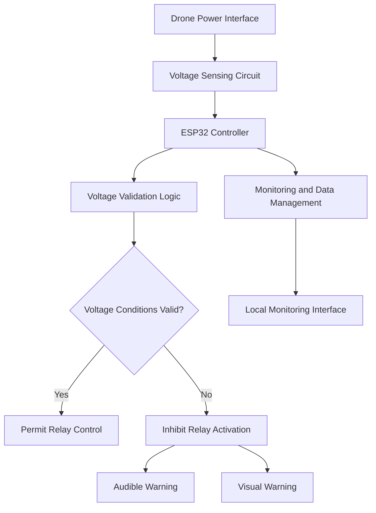

# IROC-U
🚀 IRoC-U 2026 | Building smarter and safer drone electronics with an ESP32-based BMS, intelligent power management, real-time voltage monitoring, and fail-safe circuit protection. ⚡🛡️

# 🚀 IRoC-U 2026 — Drone Electronics, BMS & Smart Power Management System

**Designing, integrating, and improving reliable drone electronics through embedded systems, intelligent power management, voltage monitoring, and circuit protection.**

---

## 📌 Table of Contents

1. [Project Overview](#-project-overview)
2. [My Contribution](#-my-contribution)
3. [Problem Statement](#-problem-statement)
4. [Project Objectives](#-project-objectives)
5. [System Architecture](#-system-architecture)
6. [Hardware Development](#-hardware-development)
7. [Voltage Monitoring System](#-voltage-monitoring-system)
8. [Circuit Protection and Safety Logic](#-circuit-protection-and-safety-logic)
9. [Embedded Firmware](#-embedded-firmware)
10. [Monitoring Interface and Data Management](#-monitoring-interface-and-data-management)
11. [Hardware Integration](#-hardware-integration)
12. [Engineering Challenges](#-engineering-challenges)
13. [Testing and Validation](#-testing-and-validation)
14. [Repository Structure](#-repository-structure)
15. [Getting Started](#-getting-started)
16. [Development Roadmap](#-development-roadmap)
17. [Safety Considerations](#-safety-considerations)
18. [Team Contribution](#-team-contribution)
19. [Project Impact](#-project-impact)
20. [Acknowledgements](#-acknowledgements)
21. [License](#-license)

---

## 🚀 Project Overview

This repository documents my electrical and electronics development work for the IRoC-U 2026 project, with a focus on drone power management, Battery Management System (BMS) development, voltage monitoring, and circuit protection.

The project involves developing and integrating embedded electronics to monitor electrical conditions, manage power connections, detect voltage mismatches, and improve the reliability of the overall system.

My work includes hardware prototyping, electronic circuit integration, sensor evaluation, embedded control, relay-based switching logic, and investigation of a custom resistor-based voltage sensing circuit.

The development process has also involved troubleshooting real-world hardware issues, including overload-related failures, excessive heating, measurement noise, and sensor calibration challenges.

Rather than treating the initial prototype as a finished design, this project follows an iterative engineering approach: build, test, identify failure points, analyze the causes, and improve the system.

### Project Focus

- **Drone Electronics:** Electrical hardware integration and power-system development.
- **BMS Development:** Battery-related monitoring and power-management functions.
- **Embedded Systems:** ESP32-based monitoring and control.
- **Voltage Sensing:** Voltage measurement, calibration, and mismatch detection.
- **Circuit Protection:** Relay interlocking, warning indications, and safer switching logic.
- **Hardware Engineering:** Prototype assembly, troubleshooting, and design improvements.
- **Monitoring Software:** Local data management and a user interface for monitoring and system management.

## 🎯 Problem Statement

Drone power systems require reliable electrical connections, accurate voltage measurements, and appropriate protection against abnormal operating conditions.

During the development of the initial hardware prototype, several practical challenges emerged:

- Hardware damage associated with overload conditions and electrical stress.
- Excessive heating affecting component reliability.
- Voltage measurement inaccuracies caused by calibration difficulties and electrical noise.
- The need to distinguish valid voltage conditions from mismatched connections.
- The need to prevent relay activation when electrical conditions are unsafe.
- The need for clearer warning indications and improved system monitoring.

These challenges highlighted the importance of combining hardware design, embedded control, sensing accuracy, and protection logic into a coordinated power-management system.

The objective is to develop and improve a system that can evaluate electrical conditions before permitting power switching, while making abnormal conditions visible to the operator.

## 🎯 Project Objectives

1. Develop and integrate drone electrical and power-management hardware.
2. Implement embedded monitoring and control using an ESP32-based controller.
3. Monitor voltage inputs and evaluate their compatibility with configured limits.
4. Investigate a custom voltage divider for improved control over voltage sensing.
5. Improve measurement accuracy through calibration and noise reduction.
6. Implement voltage mismatch detection and relay interlocking.
7. Provide audible and visual warnings during detected abnormal conditions.
8. Improve hardware reliability through systematic troubleshooting.
9. Develop supporting monitoring and data-management functionality.
10. Establish a foundation for a more compact, reliable, and maintainable hardware design.

---

## 🧑‍💻 My Contribution

My primary contribution has been in the **electrical and electronics development of the drone system**, particularly power management, BMS prototyping, embedded hardware integration, and circuit protection.

### 1. Electrical and Electronics Development

- Worked on the electrical and electronic subsystems of the drone project.
- Integrated electronic modules, power connections, control circuits, and supporting components.
- Assembled and evaluated hardware prototypes.
- Investigated electrical and hardware reliability issues during development.

### 2. BMS and Power Management

- Contributed to the development of a BMS and power-management prototype.
- Worked on voltage monitoring and controlled power switching.
- Investigated overload-related hardware failures and excessive heating.
- Identified areas requiring improvement in protection, calibration, and power-stage reliability.

### 3. Custom Voltage Sensor Investigation

- Explored a resistor-based voltage divider as a custom voltage-sensing solution.
- Investigated the challenges of sensor calibration and measurement stability.
- Considered resistor tolerances, electrical noise, ADC characteristics, and voltage scaling.
- Identified the need for repeatable calibration and comparison against a trusted measuring instrument.

### 4. Circuit Protection and Safety Logic

- Worked on voltage mismatch detection and protective control logic.
- Developed the intended sequence for warning generation and relay inhibition during a detected mismatch.
- Integrated or evaluated relay modules, buzzer indications, and visual warning components.
- Focused on preventing unintended switching when the required voltage conditions are not satisfied.

### 5. Embedded Systems and Monitoring

- Worked with ESP32-based hardware for monitoring and control.
- Contributed to the integration of sensor inputs and output-control components.
- Worked on a local database and user interface for monitoring and system management as part of the broader project work.

### 6. Prototype Testing and Improvement

- Evaluated prototype behaviour during development.
- Identified practical limitations in the initial hardware arrangement.
- Investigated measurement noise, calibration issues, overheating, and hardware damage.
- Used these findings to identify priorities for the next hardware and firmware iterations.

**My engineering approach:** Focus on understanding why a system fails, identifying the root cause, and improving the design rather than relying only on initial functional success.

---

## 🏗️ System Architecture

The system is organized around electrical sensing, embedded decision-making, controlled switching, and operator feedback.

*This diagram represents the intended system-level logic. Actual signal connections, implemented software features, and verified operating behaviour should be documented alongside the final hardware and firmware.*

### Functional Blocks

| Block | Responsibility |
|---|---|
| Power interface | Provides the electrical connection under development |
| Voltage sensing | Scales and measures the relevant voltage inputs |
| ESP32 controller | Processes sensor readings and executes control logic |
| Validation logic | Compares measurements with configured acceptance limits |
| Relay control | Permits or inhibits switching according to the validated conditions |
| Warning system | Communicates detected mismatches through audible and visual indications |
| Monitoring interface | Supports system-status monitoring and data management |

---

## 🔧 Hardware Development

The prototype combines embedded control hardware, voltage-sensing circuits, power-conversion components, relay modules, and warning indicators.

### Hardware Components

The following table describes the components used or investigated in the prototype. Exact part numbers and electrical ratings should be added after verifying the physical hardware.

| Component | Purpose |
|---|---|
| ESP32 development board | Embedded processing and control |
| Voltage-sensing modules | Measuring voltage inputs |
| Precision resistors | Voltage-divider implementation and scaling |
| Relay modules | Controlled switching of the relevant electrical connection |
| Active buzzer or suitable buzzer circuit | Audible warning indication |
| Visual indicator LEDs or lamps | Warning and operating-status indication |
| DC-DC converter | Providing an appropriate regulated supply where required |
| Capacitors | Local supply decoupling and power-stage filtering |
| Power connectors and wiring | Electrical interconnections |
| Prototype board | Initial circuit assembly and testing |
| Enclosure | Mechanical protection and hardware organization |

### Hardware Design Considerations

- Select components according to the actual maximum input voltage and current.
- Verify resistor power ratings, voltage ratings, and tolerance.
- Keep sensitive analog sensing circuits away from high-current switching paths where practical.
- Use suitable protection against reverse polarity, transients, and unintended current paths.
- Provide adequate thermal management for power-conversion and switching components.
- Ensure that the relay contacts and connectors are rated for the intended load.
- Separate low-voltage control circuitry from hazardous or high-energy power paths where applicable.

The prototype board is useful for experimentation, but the final hardware should undergo design review before being transferred to a dedicated PCB.

---

## ⚡ Voltage Monitoring System

Voltage monitoring is a central part of the project because switching decisions depend on the electrical conditions at the relevant connection points.

The controller is intended to compare the measured voltage with configured acceptance limits before allowing the system to proceed.

### Custom Resistor-Based Voltage Divider

A resistor divider is being investigated as an alternative to relying exclusively on prebuilt voltage-sensing modules.

A basic divider consists of two resistors connected in series across the input voltage. The measured output is taken across the lower resistor.

For input voltage \(V_{in}\), upper resistor \(R_1\), and lower resistor \(R_2\):

\[
V_{out}=V_{in}\frac{R_2}{R_1+R_2}
\]

The original voltage can be estimated from the measured output:

\[
V_{in}=V_{out}\frac{R_1+R_2}{R_2}
\]

The divider ratio must be chosen so that the maximum expected output voltage stays within the controller's permitted ADC input range.

### Calibration Challenges

The divider is simple, but accurate measurement requires careful implementation.

Important factors include:

- Resistor tolerance and temperature coefficient.
- ADC reference behaviour, nonlinearity, and input characteristics.
- Electrical noise from switching circuits and connected loads.
- Ground offsets and wiring resistance.
- Input filtering and sampling behaviour.
- Calibration differences between individual hardware units.

### Planned Calibration Process

1. Select appropriate resistors based on the maximum input voltage.
2. Calculate the expected divider output.
3. Verify the circuit with a trusted multimeter.
4. Compare the controller's raw ADC reading with the measured voltage.
5. Determine a correction factor or calibration equation.
6. Repeat measurements across multiple input-voltage points.
7. Evaluate the effect of electrical noise and load switching.
8. Record measurement error and confirm that the readings meet the project's acceptance criteria.

Calibration values should be stored with the relevant hardware and firmware version so that the measurements can be reproduced.

**Important:** A resistor divider is a voltage-sensing circuit, not an overcurrent protection device. It must be combined with appropriate input protection and a separately designed current-protection strategy.

---

## 🛡️ Circuit Protection and Safety Logic

The system is intended to prevent relay activation when the monitored voltage conditions do not satisfy the configured acceptance criteria.

This is particularly important when a connection is made incorrectly or a voltage mismatch is detected.

### Intended Operating Sequence

**Step 1 — System Initialization**

The controller initializes the monitoring inputs and establishes a safe default output state.

**Step 2 — Voltage Measurement**

The sensing circuit provides measurements for the connected voltage inputs.

**Step 3 — Voltage Validation**

The controller evaluates the readings against the configured limits and any required voltage relationship.

**Step 4 — Valid Condition**

Relay operation may be permitted only after the required checks pass and the system remains in a valid state.

**Step 5 — Mismatch Detection**

If a voltage mismatch or invalid condition is detected:

- Relay activation is inhibited.
- The buzzer provides a continuous warning while the fault persists.
- The visual indicator communicates the abnormal condition.
- The monitoring interface should display the relevant fault status where implemented.

**Step 6 — Fault Recovery**

The system should require valid readings to return and any required recovery checks to pass before switching is permitted again.

### Safety State Table

| Condition | Relay command | Warning |
|---|---|---|
| Initialization | OFF | Initialization status |
| Valid voltage and checks passed | Permitted by control logic | Normal status |
| Voltage mismatch | OFF | Buzzer and visual warning |
| Invalid or out-of-range reading | OFF | Fault warning |
| Sensor failure or implausible reading | OFF | Fault warning |
| Controller reset or power interruption | Hardware must default safely to OFF | Restart diagnostics |

The table describes the intended fail-safe behaviour. Actual implementation must be verified through hardware and firmware testing.

### Protection Design Principles

- Initialize relay outputs to their safe state before enabling other functions.
- Do not permit switching solely because a sensor reading appears valid once.
- Use suitable validation, filtering, and fault-detection logic.
- Consider sensor disconnection, ADC saturation, brownouts, and controller resets.
- Verify that relay-module logic levels and startup behaviour cannot cause unintended activation.
- Use appropriate fuses or other current-interruption devices where required by the power-system design.

Software-based monitoring cannot replace appropriately rated hardware protection.

---

## 💻 Embedded Firmware

The embedded controller is responsible for acquiring sensor readings, evaluating system conditions, and controlling the relevant outputs.

The firmware should be organized into separate functional modules to simplify testing and maintenance.

### Suggested Firmware Modules

| Module | Responsibility |
|---|---|
| `sensor_reading` | Acquires voltage measurements |
| `voltage_calibration` | Converts raw readings into calibrated voltage values |
| `voltage_validation` | Evaluates configured limits and mismatch conditions |
| `safety_controller` | Determines whether relay operation is permitted |
| `relay_control` | Applies the requested switching state |
| `warning_system` | Controls buzzer and visual indications |
| `fault_manager` | Tracks active faults and recovery conditions |
| `data_logger` | Records diagnostic information where implemented |
| `communication` | Transfers status information to the monitoring interface where implemented |

These are recommended module boundaries, not a claim that the repository already contains all these firmware files.

### Recommended Firmware Behaviour

- Use nonblocking timing for continuous monitoring and warning patterns where practical.
- Apply suitable filtering without hiding genuine electrical faults.
- Validate sensor readings before using them in switching decisions.
- Maintain a safe relay state during startup, reset, and invalid measurements.
- Log relevant readings, fault events, and recovery transitions when logging is available.
- Keep safety-related control logic independent of nonessential interface operations.

---

## 📊 Monitoring Interface and Data Management

The broader project work also includes a local database and user interface for monitoring and system management.

The purpose of this layer is to make system information easier to inspect and manage without treating the interface as a substitute for embedded safety controls.

### Intended Monitoring Capabilities

- Display measured voltage values where supported.
- Show the current system state.
- Indicate detected voltage mismatches and active faults.
- Record relevant diagnostic information where logging is implemented.
- Provide access to appropriate system parameters.
- Support analysis of sensor behaviour and testing results.

### Data That May Be Recorded

| Data field | Purpose |
|---|---|
| Timestamp | Establish the time of a measurement or event |
| Raw sensor reading | Support ADC diagnostics |
| Calibrated voltage | Track the calculated voltage |
| Validation state | Record whether the reading satisfies configured criteria |
| Relay command | Record the requested switching state |
| Active fault | Identify the reason for a warning |
| Recovery event | Record a return to a valid condition |

The actual database technology, interface framework, communication protocol, and supported fields should be documented once the corresponding implementation is included in this repository.

The relay safety decision should remain local to the embedded controller and should not depend on the availability of the monitoring interface.

---

## 🧩 Hardware Integration

The prototype development process involves combining several functional modules into one coordinated system.

Key integration activities include:

1. Mounting and connecting the embedded controller.
2. Integrating voltage-sensing circuits and signal wiring.
3. Connecting relay-control outputs.
4. Integrating buzzer and visual warning components.
5. Providing suitable regulated supplies for control electronics.
6. Checking wiring polarity, grounding, and connector integrity.
7. Evaluating heat generation and electrical behaviour during testing.
8. Organizing the hardware in a suitable enclosure.
9. Documenting wiring changes and hardware revisions.

The prototype images and design files should be added to the repository to document the actual development stages.

---

## ⚠️ Engineering Challenges

### 1. Overload and Hardware Damage

The initial prototype experienced hardware reliability problems associated with overload conditions, excessive heating, and electrical stress.

These issues highlighted the need to investigate load current, component ratings, protection devices, thermal dissipation, and power-stage design.

### 2. Voltage Measurement Accuracy

A voltage divider requires appropriate scaling and calibration. Measurement error can arise from resistor tolerances, ADC characteristics, electrical noise, and grounding differences.

### 3. Electrical Noise

Switching devices and power-conversion circuits can introduce noise into sensitive analog measurements. Filtering, wiring layout, grounding, and suitable sampling strategies must be evaluated together.

### 4. Relay Interlocking

The control logic must prevent relay activation during a detected voltage mismatch. Startup states, controller resets, sensor faults, and recovery behaviour must also be tested.

### 5. Prototype-to-PCB Transition

A prototype board is useful for rapid development but may introduce wiring complexity and inconsistent connections. A dedicated PCB can improve organization and repeatability after the circuit has been validated.

### Lessons Learned

- Functional operation does not automatically establish reliability.
- Measurement calibration is essential when sensor readings drive safety decisions.
- Electrical, thermal, and firmware behaviour must be evaluated together.
- Fault handling must include abnormal readings and controller startup.
- Hardware improvements should be supported by repeatable test results.

---

## 🧪 Testing and Validation

Testing should progress from individual modules to integrated-system validation.

### Recommended Test Plan

| Test | Objective | Evidence to Record |
|---|---|---|
| Controller startup | Verify safe initialization | Output states and startup logs |
| Sensor calibration | Evaluate voltage accuracy | Reference voltage and measured voltage |
| Measurement repeatability | Check stability across repeated readings | Mean, variation, and measurement error |
| Valid voltage condition | Verify acceptance logic | Input values and validation state |
| Voltage mismatch | Confirm relay inhibition | Relay state and warning behaviour |
| Sensor disconnection | Check fault detection | Detected fault and output state |
| Controller reset | Verify safe restart behaviour | Relay state before and after reset |
| Warning system | Verify audible and visual indications | Test observations |
| Thermal testing | Identify excessive heating | Temperature, load, and test duration |
| Load testing | Evaluate operation under defined loads | Current, voltage, temperature, and faults |

### Measurement Error

When validating the voltage sensor, calculate percentage error against a trusted reference:

\[
\text{Error}(\%)=
\frac{|V_{\text{measured}}-V_{\text{reference}}|}
{V_{\text{reference}}}\times100
\]

The acceptable error limit must be defined according to the actual system requirements.

No accuracy, response-time, overload-capacity, or thermal-performance figures should be reported until they have been measured and documented.

---

## 🛠️ Getting Started

### Hardware Requirements

Start with the actual components used in your prototype, including:

- Compatible ESP32 development board.
- Verified voltage-sensing circuit or module.
- Relay module with appropriate electrical ratings.
- Buzzer and visual indicators.
- Suitable power supply and connectors.
- Multimeter and appropriate testing equipment.
- Computer with the selected firmware development environment.

### Software Requirements

The software setup depends on the firmware and monitoring application actually included in the repository.

For an ESP32-based implementation, Arduino IDE or PlatformIO may be suitable, depending on the source code.

### Setup Procedure

1. Clone or download the repository.
2. Review the circuit diagrams and component specifications.
3. Install the required ESP32 development tools.
4. Open the firmware project.
5. Configure the correct controller board and pin assignments.
6. Verify the sensor scaling and calibration parameters.
7. Inspect relay startup states and fault-handling logic.
8. Test sensor readings with a safe, current-limited test setup.
9. Validate mismatch detection before connecting the intended load.
10. Review the test results and record the hardware and firmware revisions.

**Important:** Pin assignments, voltage limits, wiring connections, and dependency lists must be taken from the actual implementation rather than assumed from this overview.

---

## 🗺️ Development Roadmap

### Phase 1 — Initial Prototype

- Assemble the initial electronic hardware.
- Integrate the controller, sensing circuits, and relay modules.
- Evaluate basic power-management behaviour.

### Phase 2 — Problem Identification

- Investigate overload-related hardware failures.
- Identify thermal and electrical reliability concerns.
- Evaluate sensor calibration and measurement noise.

### Phase 3 — Sensing Improvements

- Develop and evaluate a resistor-based voltage divider.
- Improve calibration and measurement repeatability.
- Investigate suitable filtering and input protection.

### Phase 4 — Protection Logic

- Validate voltage mismatch detection.
- Implement or refine relay interlocking.
- Verify audible and visual warning behaviour.
- Test startup, sensor-fault, and recovery conditions.

### Phase 5 — Hardware Refinement

- Review circuit layout and component ratings.
- Develop a dedicated PCB where appropriate.
- Improve wiring, mechanical mounting, and enclosure integration.

### Phase 6 — System Validation

- Conduct repeatable electrical and thermal tests.
- Document measured performance and limitations.
- Review the system before any operational deployment.

Progress through these phases should be updated as work is completed and verified.

---

## 🔐 Safety Considerations

This project concerns electrical power systems, where incorrect design or wiring can damage hardware and create safety risks.

- Verify voltage and current ratings before connecting components.
- Use suitable fuses and other protection devices for the intended circuit.
- Never exceed the controller's ADC input limits.
- Ensure that the relay defaults to a safe state during startup and reset.
- Do not rely on software alone for overcurrent or thermal protection.
- Test using an appropriate current-limited supply before connecting higher-energy sources.
- Avoid testing damaged or overheated hardware.
- Verify the behaviour of every protection mechanism under realistic fault conditions.

A functioning prototype is not automatically a validated BMS or safety system. The hardware must undergo appropriate testing before being used in an operational drone.

---

## 👥 Team Contribution

The electrical and electronics development work was carried out by a small team.

- **Jaya:** Electrical and electronics development, BMS prototyping, power management, voltage monitoring, circuit protection, hardware integration, and related embedded-system development.
- **Haritha Venket:** Electrical and electronics team member contributing to the project.

Individual responsibilities should be described according to each person's actual work.

---

## 🌟 Project Impact

This project provides practical experience in developing electronics for a real engineering application.

It brings together:

- Embedded systems and microcontroller programming.
- Power electronics and electrical integration.
- Voltage measurement and sensor calibration.
- Fault detection and relay-control logic.
- Hardware troubleshooting and thermal considerations.
- Monitoring software and data management.
- Iterative design, testing, and engineering documentation.

The most important outcome of the development process is the ability to identify real hardware limitations and use those findings to guide more reliable design decisions.

---

## 🙏 Acknowledgements

Developed as part of our IRoC-U 2026 project work.

This repository documents the electrical and electronics development process, including prototype implementation, engineering challenges, and ongoing improvements.

Official event names, logos, and organizational acknowledgements should be included only in accordance with the applicable competition guidelines

---

**Built through experimentation, engineering, and continuous improvement.** ⚡

*IRoC-U 2026 | Drone Electronics | BMS | Smart Power Management | Embedded Systems*
